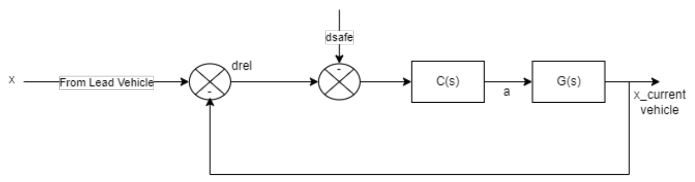
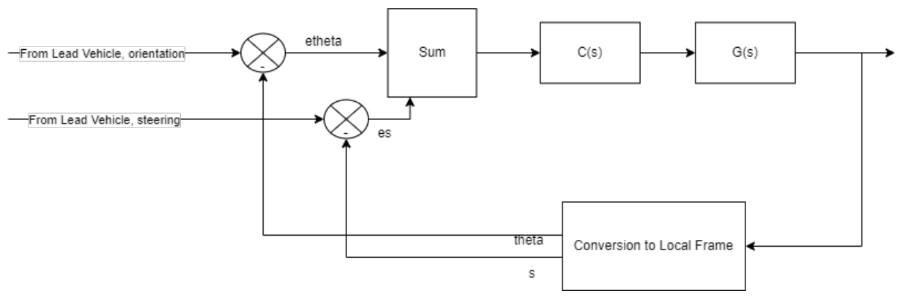
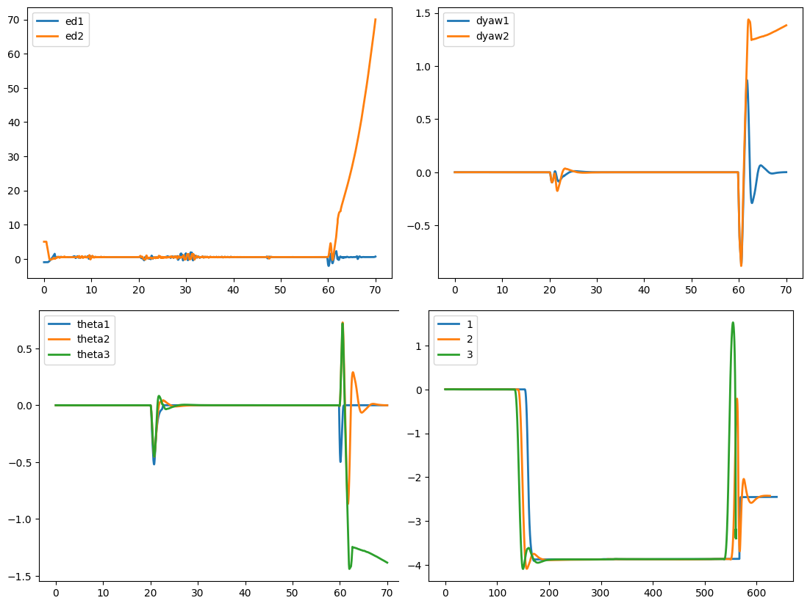

# Platoon Control of Autonomous Vehicles

A platoon is a group of connected autonomous vehicles that drive close behind each other in one formation. Each follower here only knows the state of the vehicle directly ahead (a predecessor-following communication model). The controller of every follower has to do three things:

- **Hold a safe gap.** Keep a velocity-dependent safe distance to its predecessor, `d_safe = d_default + T_gap * v_ego`, so that the distance error `e_d = d_rel - d_safe` goes to zero.
- **Follow the turns.** Match the predecessor's heading and steering, so the whole platoon follows the leader through turns and lane changes.
- **Stay intact.** Keep the platoon together when the leader's speed is disturbed or the leader changes lanes, without a disturbance growing as it passes down the platoon.

This project designs such controllers on a bicycle kinematic model in MATLAB and Simulink, proves that the distance and yaw errors converge, and then runs the controllers on full vehicle dynamics in the CARLA simulator.

Origin: IOP-2023, a group project for EEN 300 (Industry Oriented Problem) at IIT Roorkee, 2022-2023, supervised by Prof. Arnab Dey.

## Approach

The longitudinal (gap) controller and the lateral (heading) controller are independent and run in parallel. There is no reinforcement learning component. RL is only mentioned in the reports as related work and as a possible future direction for lane-change planning.

**Vehicle model.** For design and analysis, every vehicle is a bicycle kinematic model with longitudinal velocity and steering angle as inputs. During a lane change, distances and velocities are projected onto the line joining two adjacent vehicles (the angles lambda and alpha in the diagram below). This turns the lane change back into a one-dimensional distance tracking problem.


**Longitudinal control, version 1: modified MPC-based ACC.** This builds on the Model Predictive Control based Adaptive Cruise Control block that ships with Simulink. The stock block tracks the safe distance only when the gap is smaller than it, and otherwise tracks a fixed set speed. The modification replaces the set speed with a value computed from the distance error and the predecessor's velocity along the line joining the two vehicles, so the block always tracks `d_safe`.

**Longitudinal control, version 2: PID written from scratch.** A PID controller that drives `e_d` to zero. For this controller the report:
- derives the closed-loop error dynamics for each vehicle pair, and shows that the recursion does not depend on the platoon length;
- uses the final value theorem to show that the steady-state distance error is zero for an impulse disturbance in the leader's acceleration, and a bounded constant for a step disturbance.



**Lateral control.** A separate PID controller on heading:
- The follower's steering command combines the predecessor's steering angle with the yaw error between the two vehicles.
- A later version adds a lateral deviation term that vanishes as the lateral error goes to zero, so the vehicle ends up centred in the new lane.
- Convergence of the yaw error is shown in the same way as for the distance error, assuming small steering angles.



**Simulators.**
- **MATLAB and Simulink (R2022a):** used for design and analysis on the bicycle model.
- **CARLA:** used for full nonlinear vehicle dynamics on the Town04 map. In the CARLA notebook the leader drives straight and then performs a scripted lane change. The two followers run the longitudinal and orientation controllers above.

The report also describes two further pieces that are not in this repository's code:
- **Lane-change safety check:** the leader can be driven by CARLA's Traffic Manager planner, and a lane change is allowed only if a bounding box on the lane-change side of every follower is free of non-platoon vehicles.
- **Fallback:** every vehicle switches to CARLA's automatic controller if the platoon breaks.

## Results

**CARLA run (Town04, three vehicles).** The figure below is the saved output of `carla/platoon_lane_change_town04.ipynb`. The x axis of the first three panels is wall-clock time in seconds. The last panel is lateral against longitudinal displacement from each vehicle's start.



**The lane change at t = 20 s.**
- The leader moves about 3.9 m sideways (`min(DY[0]) = -3.90` in the notebook) and both followers follow it into the new lane.
- The yaw errors (`dyaw1`, `dyaw2`) return to zero within a few seconds.
- The distance errors (`ed1`, `ed2`) stay small through the manoeuvre.

**What happens near t = 60 s.**
- All three vehicles move sideways again, although the code commands no second lane change.
- Follower 2 then loses the platoon: its distance error grows to about 70 and its yaw error stays near 1.4 rad.
- `carla/platoon_lane_change_town04_sensors.ipynb` (the same experiment with a camera on the leader) shows the same pattern in its saved output.

**CARLA longitudinal-only test.** In `carla/scratch/longitudinal_pid_test.ipynb`, three vehicles in a straight line run 35 s with the PID gap controller. After the first 2 s, the largest distance errors printed are 0.60 and 0.53.

**MATLAB and Simulink**, as reported in `reports/iop_report.pdf`:
- **Speed disturbance.** For a four-vehicle one-dimensional platoon with the modified MPC-based ACC, a short pulse of acceleration on the leader at t = 35 s is absorbed. All followers readjust their velocity within about 15 s with a steady-state error close to zero.

  

- **Lane change.** For a three-vehicle platoon changing lanes at t = 25 s (lane width 3.2 m), the distance error between adjacent vehicles stays within a few millimetres throughout the manoeuvre.

  
  

- **PID controller.** With PID in place of the MPC blocks, an overtaking manoeuvre shows a small constant lateral offset that disappears once the vehicles return to the original lane, and the longitudinal error stays small. Tests with different leader inputs match the analysis: zero steady-state distance error for an impulse in acceleration, and a finite constant error for a constantly accelerating leader.

## Repository layout

```
README.md
requirements.txt                       Python packages for the CARLA side
reports/
  iop_report.pdf                       full report (24 pages): modelling, controller design, convergence proofs, planner, experiments
  IOP_MTE_Group5.pdf                   two-page summary of the MATLAB results
simulink/
  PreRun.m                             workspace parameters: sample time 0.01 s, horizon 80 s, T_gap = 1.4 s, d_default = 10 m,
                                       set speed 30 m/s, acceleration limits -3 to 2 m/s^2, initial positions and velocities
  mpcACCsystem_2.slx                   1-D platoon, leader + 3 followers, modified MPC-based ACC
  pidACCsystem.slx                     1-D platoon, leader + 3 followers, PID ACC
  ACC_bicycleModel.slx                 leader + 2 followers on the bicycle model, MPC ACC + PID yaw control (lane change)
  pidACC_bicycleModel.slx              leader + 2 followers on the bicycle model, PID ACC + PID yaw control
  scopedata.mat                        logged scope data
carla/
  platoon_lane_change_town04.ipynb     main CARLA experiment: 3-vehicle platoon, scripted lane change of the leader at t = 20 s,
                                       PID gap and heading controllers for the followers, plots of errors and trajectories
  platoon_lane_change_town04_sensors.ipynb   same experiment with an RGB camera attached to the leader
  automatic_control.py                 CARLA's automatic_control example, changed to load Town04 and spawn the leader at a fixed point
  automatic_control_with_traffic.py    same, plus Traffic Manager controlled background vehicles and walkers (add_npc)
  load_town04.py                       loads the Town04 map on a running CARLA server
  scratch/                             earlier iterations kept for reference
    platoon_lane_change_v1.ipynb       first version of the platoon notebook (per-vehicle variables); its plots match Figs. 17 and 18 of the report
    longitudinal_pid_test.ipynb        longitudinal-only PID test with three vehicles
    automatic_control.ipynb            notebook copy of automatic_control.py
    automatic_control_with_traffic.ipynb   notebook copy of automatic_control_with_traffic.py
plots/
  v_4cars, y_vs_t_3cars, d_err_car123  Simulink results as PNG, EPS and MATLAB FIG
  BKM_Diagram.png                      lane-change geometry of two adjacent vehicles
  pid_longitudinal_block.png, pid_orientation_block.png   controller block diagrams (Figs. 9 and 10 of the report)
  carla_town04_run.png                 saved plots of the main CARLA notebook
```

## How to run

### Simulink

The models were saved with MATLAB R2022a. They use these blocks:
- the Adaptive Cruise Control System block (Model Predictive Control Toolbox);
- the Bicycle Kinematic Model block (Robotics System Toolbox);
- the Stair Generator block, for the leader's velocity profile.

From `simulink/`, run `PreRun.m` first to load the parameters into the workspace, then open and run the `.slx` model of interest. Velocities and distance errors are shown on the scopes inside each model.

### CARLA

The exact CARLA release is not recorded in the project files. The code uses the `vehicle.lincoln.mkz_2020` blueprint and the `ConstantVelocityAgent` navigation agent, so it needs a CARLA 0.9.x release that includes both. The notebooks were run with Python 3.7 and 3.10.

1. Start the CARLA server, then load the map: `python carla/load_town04.py`.
2. Install the Python side: `pip install -r requirements.txt`.
   - The `carla` package must match the server version.
   - The `agents.navigation` modules imported by `automatic_control*.py` come from the `PythonAPI/carla` folder of the CARLA distribution and must be on `PYTHONPATH`.
3. Open `carla/platoon_lane_change_town04.ipynb` and run the cells in order. It does the following:
   - spawns three Lincoln MKZ 2020 vehicles, 9 m and 15 m apart;
   - drives for 70 s, with a left lane change of the leader at t = 20 s;
   - plots the distance errors, yaw errors, orientations and trajectories.

   The gains are set in the cell before the main loop: `ddef = 10`, `tgap = 1`, `kp_d = 1`, `kp_o = 0.5`, `kp_y = 1`, `kd_y = 0.2`.
4. For a leader driven by CARLA's navigation agents with background traffic, run `python carla/automatic_control_with_traffic.py --agent Behavior` with the server running. The numbers of background vehicles and walkers default to 0 and are set by the argument defaults inside `add_npc`.

## Limitations

- **CARLA breakup.** In both saved CARLA runs the platoon does not stay intact for the full 70 s. Near t = 60 s the vehicles move sideways again, and the second follower falls away with a growing distance error. The notebooks do not record why. The report's CARLA figures (Figs. 17 and 18) use the same plot labels as the earlier `scratch/platoon_lane_change_v1.ipynb`, not this notebook.
- **Proof assumptions.** The convergence proofs use the bicycle kinematic model and, for heading, a small steering angle assumption. String stability in the formal sense is not proven. The report lists it as future work.
- **Safety logic not in the code.** The lane-change safety check and the fallback to CARLA's automatic controller are described in the report but are not in this repository's code. In `platoon_lane_change_town04.ipynb` the leader follows a scripted lane change, not a planner.
- **Simulation time.** The CARLA loop uses wall-clock time, not a fixed simulation step, so results depend on the speed of the machine running the server.
- **Fixed scenario.** Only homogeneous platoons (identical vehicles) on one map (Town04) were tested. The exact CARLA version is not recorded.

## Credits

Amisha Verma, Archana Singh, Ritvik Mahajan, Sameer Talwar, Shreshth Mehrotra.

`carla/automatic_control.py` is derived from the CARLA `automatic_control.py` example (Copyright 2018 Intel Labs, MIT licence). The report builds on the MPC-based ACC formulation of Al-Gabalawy et al. (Int. J. Dynam. Control, 2021) and the string stability definitions of Feng et al. (Annual Reviews in Control, 2019). The full reference list is in the report.
