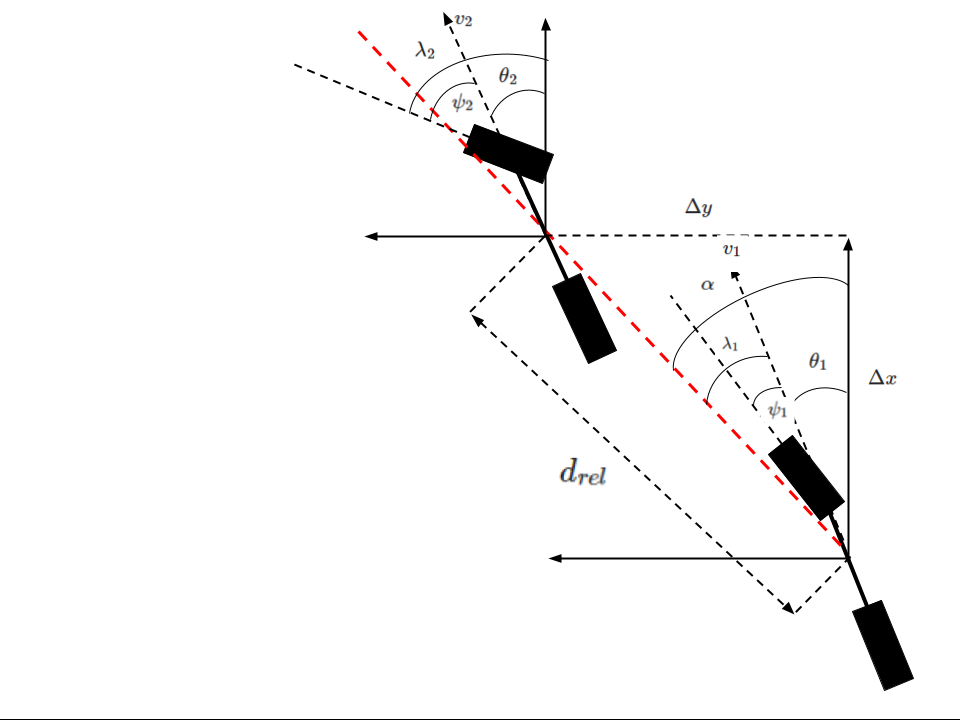
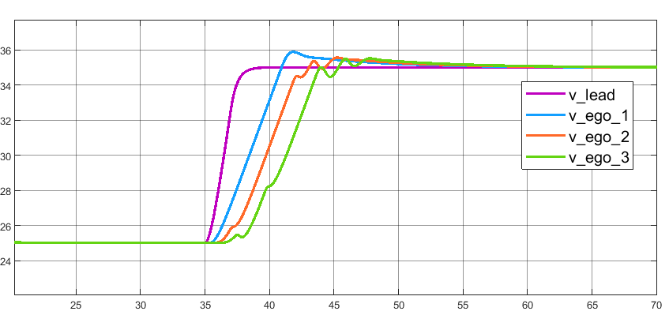
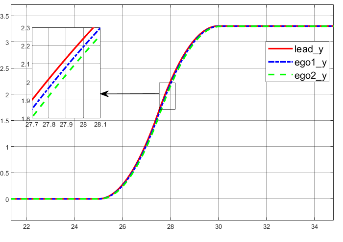
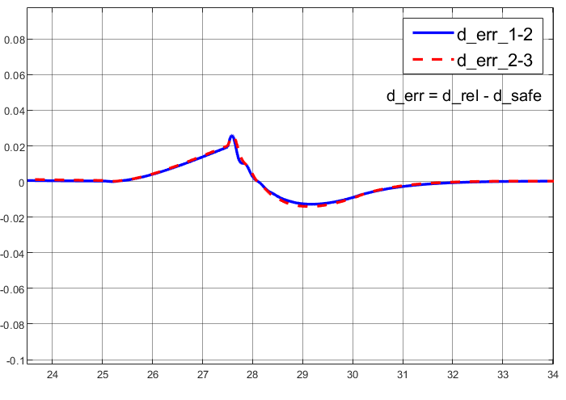

# Platoon Control of Autonomous Vehicles

Longitudinal and lateral control of a platoon of connected autonomous vehicles, including a coordinated lane change of the whole platoon. The platoon uses a predecessor-following communication model: each follower measures its distance to, and the heading of, the vehicle directly ahead and tries to hold a velocity-dependent safe distance (d_safe = d_default + T_gap * v_ego) while matching the predecessor's yaw. Controllers were first designed and analysed on a bicycle kinematic model in MATLAB and Simulink, then re-implemented on top of the full vehicle dynamics in the CARLA simulator. The full write-up is in [reports/iop_report.pdf](reports/iop_report.pdf); a two-page summary is in [reports/IOP_MTE_Group5.pdf](reports/IOP_MTE_Group5.pdf).

## Approach

Longitudinal control was done in two ways. The first is a modified Adaptive Cruise Control (ACC) built around the Model Predictive Control based ACC block that ships with Simulink. The stock block only tracks the safe distance when the gap is smaller than it, and otherwise tracks a fixed set speed. The modification replaces the constant set speed with a quantity derived from the distance error and the predecessor's velocity component along the line joining the two vehicles, so the block always tracks d_safe. The second is a PID controller written from scratch that drives the distance error e_d = d_rel - d_safe to zero. For this controller the report derives the closed-loop error dynamics for the i-th vehicle pair, shows the recursion is independent of platoon length, and uses the final value theorem to show that the steady-state distance error is zero for an impulse disturbance in the leader's acceleration and a bounded constant for a step disturbance.

Lateral control is an independent PID controller on the orientation error between adjacent vehicles. The steering command for a follower combines the predecessor's steering angle with the yaw error, and a later version adds a lateral deviation term (so the vehicle ends up centred in the new lane) that vanishes as the lateral error goes to zero. Convergence of the yaw error is shown the same way as for the distance error, under a small steering angle assumption on the bicycle model. During a lane change all distances and velocities are projected onto the line joining the two vehicles (the angles lambda and alpha in the diagram below), which turns the lane change back into a one-dimensional distance tracking problem. The two controllers run in parallel.



In CARLA the leader runs CARLA's own Traffic Manager based planner and controller towards a goal location, and the followers run the longitudinal and orientation controllers above. The report also describes a simple safety check on top of this: when the leader's steering command exceeds a threshold, a rectangular bounding box on the lane-change side of every follower is checked for vehicles that are not part of the platoon. The lane change goes ahead only if all boxes are clear; otherwise the leader's steering is overridden and the platoon stays in its lane. If the platoon breaks for any reason, every member falls back to CARLA's default automatic controller.

## Results

All numbers below are taken from the reports.

MATLAB and Simulink, modified MPC based ACC plus PID yaw control. For a four-vehicle one-dimensional platoon given a short pulse of acceleration on the leader at t = 35 s, all followers readjust their velocity within about 15 s with a steady-state error close to zero.



For a three-vehicle platoon performing a lane change at t = 25 s (lane width 3.2 m), the distance error between adjacent vehicles stays within a few millimetres in magnitude throughout the manoeuvre.





MATLAB and Simulink, PID longitudinal control. With the PID controller in place of the MPC blocks, an overtaking manoeuvre shows a very small constant lateral offset that disappears once the vehicles return to the original lane, and the longitudinal error stays small. Tests with different leader inputs confirm the analysis: zero steady-state distance error for an impulse in acceleration, a finite constant error for a constantly accelerating leader.

CARLA. With a three-vehicle platoon on Town04 and the full nonlinear vehicle model, both the distance and orientation errors converge to zero, and after the lane change (lane width 4 m) the vehicles settle in the middle of the new lane with minimal overshoot (Figs. 17 and 18 in the report).

## Repository layout

```
.
|-- README.md
|-- requirements.txt            Python packages for the CARLA side
|-- simulink/
|   |-- PreRun.m                Workspace parameters (Ts, T_gap, D_default, initial states, ...)
|   |-- mpcACCsystem_2.slx      1-D platoon, lead + 3 followers, modified MPC based ACC
|   |-- pidACCsystem.slx        1-D platoon, lead + 3 followers, custom PID ACC
|   |-- ACC_bicycleModel.slx    Lead + 2 followers on the bicycle model, MPC ACC + PID yaw control
|   |-- pidACC_bicycleModel.slx Lead + 2 followers on the bicycle model, PID ACC + PID yaw control
|   `-- scopedata.mat           Logged scope data
|-- carla/
|   |-- platoon_lane_change_town04.ipynb          Main CARLA experiment: 3-vehicle platoon, lane change on Town04
|   |-- platoon_lane_change_town04_sensors.ipynb  Same, with an RGB camera attached to the leader
|   |-- automatic_control.py                      CARLA's automatic_control example, loads Town04 and spawns the leader at a fixed point
|   |-- automatic_control_with_traffic.py         Same, plus Traffic Manager controlled background traffic and walkers
|   |-- load_town04.py                            Loads the Town04 map on a running server
|   `-- scratch/                                  Earlier iterations kept for reference
|       |-- platoon_lane_change_v1.ipynb          First version of the platoon notebook (per-vehicle variables, no map load)
|       |-- longitudinal_pid_test.ipynb           Longitudinal-only PID test on three vehicles
|       |-- automatic_control.ipynb               Notebook copy of automatic_control.py
|       `-- automatic_control_with_traffic.ipynb  Notebook copy of automatic_control_with_traffic.py
|-- plots/                      PNG, EPS and FIG exports of the Simulink results, plus the geometry diagram
`-- reports/
    |-- iop_report.pdf          Full project report (24 pages)
    `-- IOP_MTE_Group5.pdf      Two-page summary
```

## How to run

### Simulink

The models were saved with MATLAB R2022a. They use the Adaptive Cruise Control System block (Model Predictive Control Toolbox), the Bicycle Kinematic Model block (Robotics System Toolbox) and the Stair Generator block for the leader's velocity profile. From the `simulink/` folder run `PreRun.m` first to put the parameters into the workspace (sample time 0.01 s, horizon 80 s, T_gap = 1.4 s, d_default = 10 m, set speed 30 m/s, acceleration limits -3 to 2 m/s^2, initial positions and velocities of the lead and follower cars), then open and run the `.slx` model of interest. Velocities and distance errors are shown on the scopes inside the model.

### CARLA

The exact CARLA release is not recorded in the project files. The code uses the `vehicle.lincoln.mkz_2020` blueprint and the `ConstantVelocityAgent` navigation agent, so a CARLA 0.9.x release that includes both is needed. The notebooks were run with Python 3.7 and 3.10.

1. Start the CARLA server, then load the map: `python carla/load_town04.py`.
2. Install the Python side: `pip install -r requirements.txt`. The `carla` package must match the server version; the `agents.navigation` modules imported by `automatic_control*.py` come from the `PythonAPI/carla` folder of the CARLA distribution and need to be on `PYTHONPATH` (the scripts also try to add it relative to their own location, as in the original CARLA example).
3. Open `carla/platoon_lane_change_town04.ipynb` and run the cells in order. It spawns three Lincoln MKZ 2020 vehicles 9 m and 15 m apart, drives for 70 s, starts a left lane change of the leader at t = 20 s, and then plots the distance error, yaw error, orientation and x-y trajectories of the three vehicles with matplotlib. Controller gains (d_default = 10, T_gap = 1, k_p,d = 1, k_p,o = 0.5, k_p,y = 1, k_d,y = 0.2) are set in the cell before the main loop.
4. For a leader driven by CARLA's navigation agents with background traffic, run `python carla/automatic_control_with_traffic.py --agent Behavior` with the server running. The script loads Town04, spawns Traffic Manager controlled vehicles and walkers (the counts default to 0 and are set by the argument defaults inside `add_npc`), and runs the chosen agent to a random destination with a pygame window showing the leader's view.

## Team

Group project for EEN 300: Industry Oriented Problem (IOP/MTE Group 5), Department of Electrical Engineering, IIT Roorkee, 2022-2023, supervised by Prof. Arnab Dey.

Amisha Verma, Archana Singh, Ritvik Mahajan, Sameer Talwar, Shreshth Mehrotra.

`carla/automatic_control.py` is derived from the CARLA `automatic_control.py` example (Copyright 2018 Intel Labs, MIT licence).

## References

The report builds on the MPC based ACC formulation of Al-Gabalawy et al. (Int. J. Dynam. Control, 2021) and the string stability definitions of Feng et al. (Annual Reviews in Control, 2019). The full reference list is in the report.
